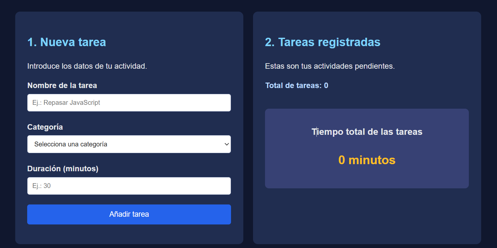

# Actividad final · Documenta tu proyecto con README.md

Ya has desarrollado tu aplicación **Mi agenda de tareas**. Ahora vamos a aprender a presentarla como lo haríamos en un proyecto profesional de GitHub.

Un `README.md` permite explicar qué hace una aplicación, cómo utilizarla, qué tecnologías se han empleado y qué hemos aprendido durante su desarrollo.

## 1. Crea tu archivo README.md

Abre la carpeta de tu proyecto en Visual Studio Code y crea un archivo llamado exactamente `README.md`.

Utiliza Markdown para organizarlo con títulos, listas, imágenes y enlaces.

Puedes consultar estos recursos:

- [DevCampus · Proyectos](https://devcampus.es/proyectos)
- [README.so · Editor visual](https://readme.so/editor)
- [GitHub · Guía de Markdown](https://docs.github.com/es/get-started/writing-on-github/getting-started-with-writing-and-formatting-on-github/basic-writing-and-formatting-syntax)

Para previsualizar el README en VS Code, utiliza `Ctrl + Shift + V`.

## 2. Completa los apartados de tu README

Copia la siguiente estructura en tu archivo y sustituye las preguntas por explicaciones propias.

### Título del proyecto

Utiliza un título principal con `#` e indica el nombre de tu aplicación.

### Descripción

- ¿Qué tipo de aplicación has creado?
- ¿Para qué sirve?
- ¿Qué problema ayuda a resolver?

Redacta un pequeño párrafo que presente tu proyecto.

### Captura de la aplicación

Incluye la primera imagen utilizando Markdown:

```markdown

```

### Funcionalidades

¿Qué puede hacer una persona que utiliza tu aplicación?



Escribe una lista con las funcionalidades que hayas desarrollado realmente.

### Tecnologías utilizadas

Explica brevemente qué has utilizado y para qué:

- **HTML5:** ¿qué estructura y elementos has creado?
- **CSS3:** ¿qué aspectos visuales has diseñado?
- **JavaScript:** ¿qué funcionalidades has programado?

### Cómo utilizar la aplicación

- ¿Cómo se abre el proyecto?
- ¿Es necesario instalar algún programa o dependencia?
- ¿Cómo puede el usuario añadir una tarea?

Escribe instrucciones sencillas para alguien que nunca ha utilizado tu aplicación.

### Ejemplo de funcionamiento

Incluye la segunda imagen:

```markdown

```

Explica qué muestra esta captura y qué ocurre en la aplicación.

### ¿Cómo funciona JavaScript?

Explica con tus palabras:

- ¿Dónde se almacenan las tareas mientras utilizas la aplicación?
- ¿Cómo recorres el array para mostrar las tareas?
- ¿Qué ocurre cuando añades una tarea nueva?
- ¿Cómo calculas el tiempo total?
- ¿Por qué necesitamos actualizar el HTML después de modificar el array?

No es necesario copiar todo el código. Queremos que expliques su funcionamiento.

### Aprendizajes

- ¿Qué conocimientos de JavaScript has practicado?
- ¿Qué parte del desarrollo te ha resultado más difícil?
- ¿Qué has aprendido resolviendo esa dificultad?

### Posibles mejoras

¿Qué dos funcionalidades añadirías a la aplicación en una próxima versión?

### Autor

Incluye tu nombre y, si tienes una cuenta de GitHub, puedes añadir un enlace a tu perfil.

## 3. Organización del proyecto

Comprueba que tienes una estructura similar a esta:

```text
tareas/
├── index.html
├── styles.css
├── app.js
├── README.md
└── images/
    ├── intro.png
    └── uso.png
```

Las imágenes deben enlazarse mediante rutas relativas como `images/intro.png`.

No utilices rutas de tu ordenador como `C:\Users\...`, porque no funcionarán cuando otra persona descargue el proyecto.

## 4. Revisión final

Antes de entregar, comprueba:

- [ ] El README tiene un título y una descripción clara.
- [ ] He explicado las funcionalidades reales.
- [ ] He indicado las tecnologías utilizadas.
- [ ] Las dos imágenes aparecen correctamente.
- [ ] He explicado cómo ejecutar la aplicación.
- [ ] He descrito qué he aprendido.
- [ ] He incluido mi autoría.
- [ ] He eliminado las preguntas y las he sustituido por mis respuestas.

## Entrega

Guarda `README.md` en la carpeta principal del proyecto, junto a `index.html`.

Comprime la carpeta completa en formato ZIP, incluyendo el código, las imágenes y el README.

**El objetivo no es escribir mucho, sino aprender a presentar tu trabajo de forma clara, comprensible y profesional.** Un buen README permite que otra persona entienda tu proyecto incluso antes de ejecutarlo.